# Genesys Cloud Multi-Lingual State-Machine IVR Architecture

A sanitized, IP-safe reference architecture for a multi-lingual Genesys Cloud voice routing flow built around modular reusable tasks, data-driven market/operating-hour resolution, bounded retry loops, customer verification, and dynamic time-to-event queue prioritization.

> **Sanitization & Scope Note:** All proprietary company names, internal identifiers, and domain-specific terms from legacy whiteboard designs have been generalized into enterprise equivalents. Exact numerical weights in the priority logic are reconstructed conceptually from architectural recall rather than copied from original design.

---

## Architecture Overview

Rather than duplicating routing logic across dozens of static branches - or cloning separate flows for each language - this design organizes call handling into **reusable tasks** driven by normalized phone inputs, a **Data Table** for static DNIS-to-language/schedule mapping, **Schedule Groups** for dynamic operating hours, and **Data Actions** for live custom CRM/booking lookups.

### Key Design Patterns

* **Phone Normalization at Entry:** `ANI` and `DNIS` (`Call.CalledAddress`) are normalized up front (stripping `tel:` prefixes into canonical E.164 format) so Data Table lookups and caller ANI matching behave predictably.
* **Data Table + Schedule Groups:** A Data Table (`DNIS_Routing_Config`) maps normalized DNIS keys to uppercase language codes (`EN`, `ES`, `DE`, `UA`, `JA`) and a schedule group reference, while native Genesys Cloud Schedule Groups handle operating hours, holidays, and `Europe/Prague` timezone/DST transitions dynamically.
* **Dynamic Prompt & Queue Resolution:** Prompts and queues are resolved dynamically at runtime using `Flow.Language` expressions (such as `FindUserPrompt(Append(Flow.Language, "_welcome"))` and `FindQueue("Call_" + Flow.Language)` with a safe `Call_EN` fallback).
* **Bounded Retry Loops & Safe Exits:** Identifier collection and date-of-birth (DOB) verification enforce explicit 3-attempt limits with clear prompts and disconnects or agent-script escalation flags when exceeded.
* **Context-Aware Routing & Time-to-Event Priority:** After verification and calculating time to event in minutes, calls evaluate interaction context (urgent/on-site status, repeat callers, priority/VIP tiers, open tickets) and time-to-event menus (`> 48h`, `< 48h`, post-event `< 0`), computing `Flow.Priority` from urgency factors (proximity to event, service package, and VIP status) so urgent callers can surpass queue backlogs via `10 + ToNum(Flow.Priority)`.

### Dynamic Prompt Strategy & Key Prompts

Prompts are resolved dynamically using `Flow.Language` so localized audio stays decoupled from routing logic. Rather than listing every voice prompt in the flow, only prompts that clarify **user input, retry loops, or call termination** are highlighted below:

* **Entry & Opening Hours:** Welcome prompt (`*_welcome`), closed-line notice and English offer, and unsupported-language disconnect prompt when a caller declines English outside operating hours.
* **Identifier Collection & Retries:** Initial prompt asking for the identifier, `*_identifier_incorrect` (and retry prompt) on invalid input or lookup errors across up to 3 attempts, and a disconnect prompt advising the caller to double-check their details and call back after 3 failed attempts.
* **Verification (DOB):** Prompt requesting date of birth when ANI does not match, plus retry prompting across up to 3 attempts before flagging the agent script for full manual verification.
* **Menus & Transfer:** Time-to-event menu prompts, survey opt-in prompt (where applicable), and dynamic queue/in-queue prompts resolved via `Flow.Language`.

---

## End-to-End Call Flow

```mermaid
flowchart TD
    Start([Inbound Call]) --> Norm["Normalize ANI & DNIS<br/>(Strip 'tel:' to E.164)"]
    Norm --> DTLookup["Data Table Lookup: DNIS_Routing_Config<br/>(Key: Normalized DNIS -> Flow.Language, ScheduleGroup)"]
    DTLookup --> PlayWelcome["Play Dynamic Prompt:<br/>FindUserPrompt(Flow.Language + '_welcome')"]
    PlayWelcome --> TaskHours[[Reusable Task: Opening Hours]]

    %% Reusable Task: Opening Hours
    subgraph TaskHours [Reusable Task: Opening Hours]
        direction TB
        OHCheck["Evaluate Schedule Group<br/>(Europe/Prague for Flow.Language)"] --> IsOpen{"Line Open?"}

        IsOpen -->|Yes| OfferENOpen["Offer English Option<br/>(e.g., wait-time relief)"]
        OfferENOpen -->|Selected EN| SetENOpen["Flow.Language = 'EN'"]
        OfferENOpen -->|Did Not Select EN| KeepLangOpen["Keep Flow.Language"]

        IsOpen -->|No / Closed| IsNotEN{"Flow.Language != 'EN'?"}
        IsNotEN -->|No - Already EN| PlayClosedEN["Play Closed Prompt"]
        PlayClosedEN --> DiscEN([Disconnect Call])

        IsNotEN -->|Yes| InformClosed["Inform Line Is Closed &<br/>Offer to Continue in English"]
        InformClosed -->|Selected EN| SetENClosed["Flow.Language = 'EN'"]
        InformClosed -->|Did Not Select EN| PlayNoSupport["Play Prompt: Cannot Support<br/>In Your Language Right Now"]
        PlayNoSupport --> DiscNoSupport([Disconnect Call])
    end

    SetENOpen --> TaskID[[Reusable Task: Identifier Input]]
    KeepLangOpen --> TaskID
    SetENClosed --> TaskID

    %% Reusable Task: Identifier Input
    subgraph TaskID [Reusable Task: Identifier Input]
        direction TB
        IDInit["Attempts = 0"] --> AskID["Prompt for Identifier & Collect Input"]
        AskID --> IDLookupDA["Data Action: Validate / Lookup Order"]
        IDLookupDA -->|Success| IDDone([Identifier Valid])
        IDLookupDA -->|Error / Invalid| IDInc["Attempts++"]
        IDInc --> IDMax{"Attempts < 3?"}
        IDMax -->|Yes| PlayIDBad["Play Dynamic Prompt:<br/>Flow.Language + '_identifier_incorrect'"]
        PlayIDBad --> AskID
        IDMax -->|No - 3 Failed| PlayIDDisc["Play Prompt: Double-Check Info<br/>& Call Again"]
        PlayIDDisc --> DiscID([Disconnect Call])
    end

    IDDone --> TaskDA[[Reusable Task: Data Actions]]

    %% Data Actions Task
    subgraph TaskDA [Reusable Task: Data Actions]
        direction TB
        CallCRM["Call Custom CRM Endpoints via Data Actions<br/>(Booking Details, Customer, Tickets, Context)"]
    end

    TaskDA --> TaskVerify[[Reusable Task: Verification]]

    %% Verification Task
    subgraph TaskVerify [Reusable Task: Verification]
        direction TB
        ANIMatch{"Normalized ANI Matches<br/>CRM Record?"}
        ANIMatch -->|Yes| MarkVerified["Mark Booking / Caller Verified"]
        ANIMatch -->|No| DOBInit["DOB Attempts = 0"]
        DOBInit --> AskDOB["Prompt for Date of Birth & Collect"]
        AskDOB --> DOBMatch{"DOB Matches?"}
        DOBMatch -->|Yes| MarkVerified
        DOBMatch -->|No| DOBInc["DOB Attempts++"]
        DOBInc --> DOBMax{"DOB Attempts < 3?"}
        DOBMax -->|Yes| AskDOB
        DOBMax -->|No - 3 Failed| ScriptFullVer["Set Script Flag:<br/>Full Manual Verification Required"]

        MarkVerified --> CalcMins["Calculate Time to Event (in Minutes)"]
        ScriptFullVer --> CalcMins
        CalcMins --> CalcPrio["Calculate Flow.Priority Boost<br/>(Closer to Event + Tier/VIP/Package<br/>to Surpass Queue Backlogs)"]
    end

    CalcPrio --> TaskSwitch[[Reusable Task: Switch]]

    %% Reusable Task: Switch
    subgraph TaskSwitch [Reusable Task: Switch]
        direction TB
        CtxEval{"Switch: Interaction Context"}

        CtxEval -->|Urgent / Guarantee| CheckOnSite{"Urgent On-Site<br/>Status?"}
        CheckOnSite -->|Yes| BoostPrio["Update Data: Apply High Urgency Boost<br/>to Flow.Priority"]
        BoostPrio --> DynACD

        CheckOnSite -->|No| AskTicket1["Collect Input:<br/>Calling about Open Ticket? (1=Yes, 2=No)"]
        AskTicket1 -->|Yes| DynACD
        AskTicket1 -->|No| TaskMenu

        CtxEval -->|Repeat Caller| DynACD
        CtxEval -->|Priority Partner| DynACD

        CtxEval -->|Has Open Tickets| AskTicket2["Collect Input:<br/>Calling about Open Ticket? (1=Yes, 2=No)"]
        AskTicket2 -->|Yes| DynACD
        AskTicket2 -->|No| TaskMenu

        CtxEval -->|No Open Tickets / Default| TaskMenu
    end

    %% Reusable Task: Menu & Dynamic ACD Transfer
    subgraph TaskMenu [Reusable Task: Menu & Dynamic ACD]
        direction TB
        TimeSwitch{"Switch: Time_To_Event (Minutes)"}

        TimeSwitch -->|"> 48 Hours (2,880m)"| MenuLong["Collect Input:<br/>1. Ancillary Services<br/>2. Documentation<br/>3. Modification / Cancel<br/>4. General Info<br/>5. Complaints (Optional)"]
        TimeSwitch -->|"< 48 Hours (2,880m)"| MenuShort["Collect Input:<br/>1. Documentation<br/>2. Modification / Cancel<br/>3. General Info<br/>4. Complaints (Optional)"]
        TimeSwitch -->|"< 0 Minutes (Post-Event)"| MenuPost["Collect Input:<br/>1. Refund / Invoice<br/>2. General Inquiry<br/>3. Complaints (Optional)"]

        MenuLong --> SetReason["Update Data:<br/>Set WrapUp_Reason & Exit_Code"]
        MenuShort --> SetReason
        MenuPost --> SetReason

        SetReason --> TierSwitch{"Switch: Customer Tier"}
        TierSwitch -->|Service Package /<br/>Priority Partner| SurveyPrompt
        TierSwitch -->|Default| SurveyPrompt["Collect Input:<br/>Post-Call Survey Opt-In? (1=Yes, 2=No)"]

        SurveyPrompt -->|1 / Yes| ScriptSurvey["Set Screen-Pop Script:<br/>Survey_OptIn_Script"]
        SurveyPrompt -->|2 / No| ScriptStd["Set Screen-Pop Script:<br/>Standard_Agent_Script"]

        ScriptSurvey --> DynACD
        ScriptStd --> DynACD

        subgraph DynACD [Reusable Task: Dynamic Transfer to ACD]
            direction TB
            ResPrompt["Resolve Prompt:<br/>FindUserPrompt(Flow.Language + '_' + Flow.Menu)"]
            ResPrompt --> ResQueue["Resolve Queue:<br/>FindQueue('Call_' + Flow.Language)"]
            ResQueue -->|Queue Not Found| SafeQueue["Fallback Queue: 'Call_EN'"]
            ResQueue -->|Queue Found| ExecTransfer["Transfer to ACD<br/>Queue = ResolvedQueue<br/>Priority = 10 + ToNum(Flow.Priority)<br/>ScreenPop = SelectedScript"]
            SafeQueue --> ExecTransfer
        end
    end
```



---

## Reusable Tasks & Responsibilities

| Stage / Task | Primary Inputs | Key Logic & Integrations | Outcome / Handoff |
| :--- | :--- | :--- | :--- |
| **Entry & DNIS Lookup** | `Call.CalledAddress`, `Call.Ani` | Normalize phone numbers; lookup `Flow.Language` and schedule reference from `DNIS_Routing_Config`; play `*_welcome` prompt | Enters **Opening Hours** task |
| **Opening Hours** | `Flow.Language`, Schedule Group | Evaluate open/closed status (`Europe/Prague`); offer English when open or when a non-English line is closed; disconnect with unsupported-language prompt if declined after hours | Proceeds with `Flow.Language` or disconnects |
| **Identifier Input** | Caller DTMF/input | 3-attempt loop calling order Data Action; plays `*_identifier_incorrect` on invalid/error; disconnects after 3 failed tries | Enters **Data Actions** task |
| **Data Actions** | Verified identifier (`reference_id`) | Queries custom CRM endpoints for booking details, customer profile, tickets, and context | Enters **Verification** task |
| **Verification** | Normalized ANI, CRM record, DOB | Checks ANI match first; otherwise runs 3-attempt DOB loop; flags agent script for manual verification after 3 DOB failures; computes time to event in minutes and `Flow.Priority` | Enters **Switch** task |
| **Switch** | Context flags, on-site status, open tickets | Routes urgent/on-site, repeat callers, priority partners, or open-ticket callers directly or into **Menu** | Direct ACD transfer or **Menu** task |
| **Menu & ACD Transfer** | `Time_To_Event` (minutes), tier, `Flow.Language`, `Flow.Priority` | Presents time-windowed options, assigns wrap-up/exit codes and screen-pop script, resolves queue/prompt dynamically, transfers with `10 + ToNum(Flow.Priority)` | Agent / ACD queue handoff |

---

## Repository Structure

```text
.
├── README.md
├── docs/
│   ├── crm-data-action.md
│   └── data-table-and-schedule-design.md
└── terraform/
    ├── providers.tf
    ├── data_tables.tf
    ├── schedules.tf
    └── queues.tf
```

---

## Scope & Extension Boundaries

* **Deliberately Excluded Virtual Agent / Bot Code:** This repository reflects production routing patterns experienced directly rather than unverified bot/NLU implementations.
* **Future Extension Point:** If a bot flow (`Call Bot Flow`) is introduced later, a natural integration point sits after **Verification** once customer context and verification status are established.
